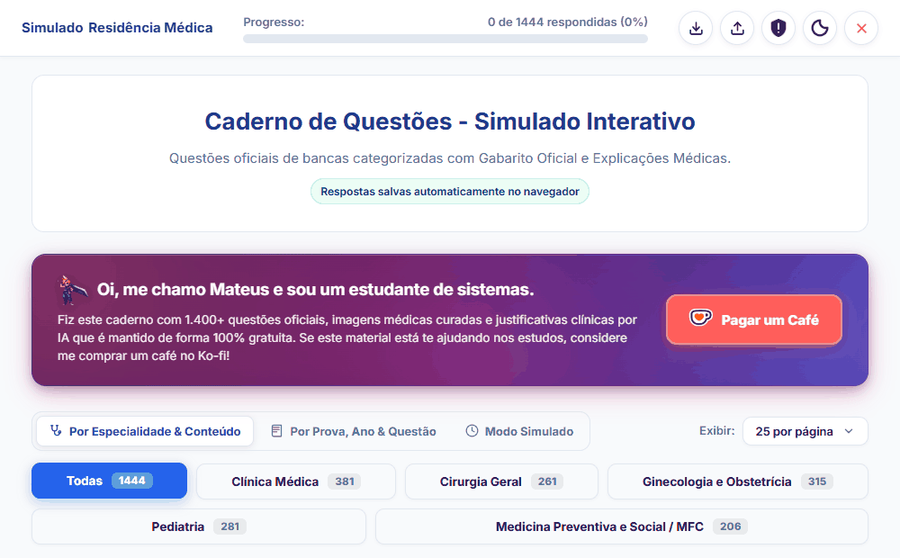
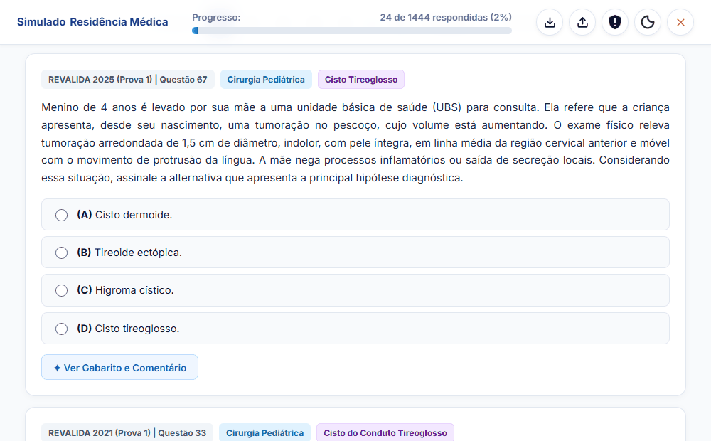
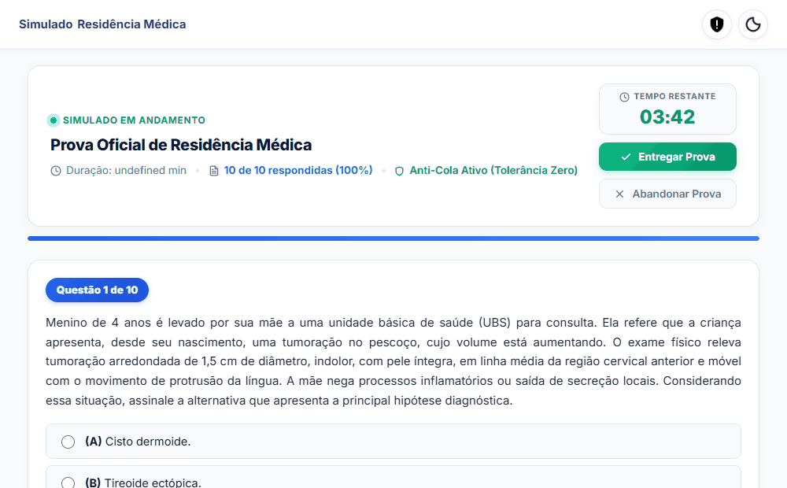
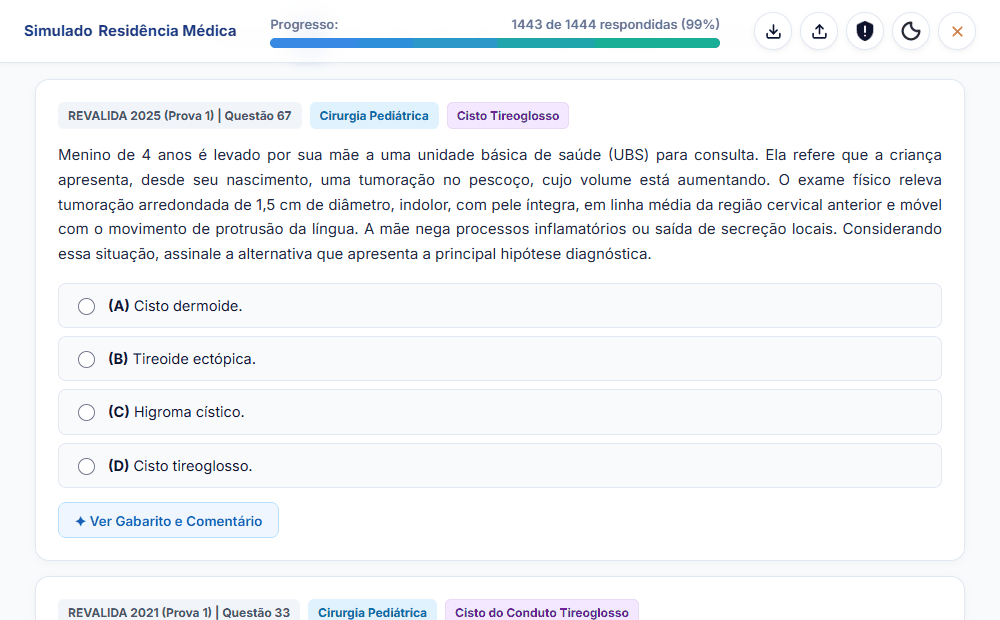

# 🩺 Caderno de Questões — Residência Médica, ENARE & Revalida

> **Plataforma interativa e moderna para resolução de questões médicas com gabarito oficial e raciocínio clínico por IA. Acesse online diretamente no navegador ou utilize offline com portabilidade total.**

---

Caderno interativo de questões focado nos principais concursos de **Residência Médica do Brasil, ENARE e Revalida**. Desenvolvido para oferecer uma experiência de estudo fluida, conta com enunciados fiéis, imagens originais e gabarito oficial validado, com curadoria ativa para eliminar duplicidades e tratar questões anuladas. 

Cada questão acompanha comentários e raciocínio clínico objetivo gerados por inteligência artificial para resolução rápida de dúvidas. Projetado com máxima flexibilidade: **estude online diretamente pelo navegador via GitHub Pages ou baixe apenas o arquivo `index.html` para ter acesso completo e offline em qualquer lugar, sem necessidade de servidores, logins ou cadastros.**

---

## 🧭 Demonstração Interativa

### 1. Visão Geral e Navegação Fluida

Interface limpa, minimalista e pensada para evitar o cansaço visual em longas sessões de estudo. Conta com paginação instantânea, barra de progresso em tempo real, temas Claro/Escuro e filtros dinâmicos por banca examinadora, ano de aplicação e grande área médica.

* **Design Distraction-Free:** Sem banners, anúncios ou poluição visual — foco 100% no conteúdo da questão.
* **Imagens Médicas Originais:** Radiografias, tomografias, lâminas histológicas e traçados de ECG integrados diretamente ao enunciado.
* **Filtros Ágeis:** Segmentação rápida por bancas (ENARE, Revalida, etc.), edições e temas clínicos.

---

### 2. Resolução Ativa & Raciocínio Clínico via IA

Pratique com feedback imediato. Ao selecionar sua alternativa e abrir os comentários, você valida a resposta oficial e tem acesso a um raciocínio médico completo, conciso e livre de prolixidade.

* **Gabarito Oficial Validado:** Conferência direta com as publicações definitivas das bancas organizadoras.
* **Justificativa Médica e Fisiopatológica:** Explicação concisa fundamentada nos principais consensos e diretrizes clínicas do Brasil.
* **Análise das Alternativas Incorretas:** Entenda exatamente o erro de cada distrator para não cair em pegadinhas nas provas.

---

### 3. Modo Simulado com Controle de Tempo Real

Treine no mesmo ritmo do dia da prova. O modo simulado isola as distrações, ativa um cronômetro regressivo e monitora o seu tempo por questão.

* **Ambiente de Prova:** Cronômetro regressivo com contagem oficial e bloqueio de consultas ao gabarito durante a execução.
* **Controle de Pendências:** Acompanhamento em tempo real das questões respondidas e pendentes antes do envio final.
* **Relatório Oficial de Desempenho:** Apuração automática ao entregar o simulado, detalhando porcentagem de acertos, tempo médio por questão e faixa de aproveitamento.

---

## ⚡ Destaques Técnicos e Portabilidade

* **Acesso Híbrido (Online e Offline):** Use direto pela web ou salve o arquivo `index.html` para estudar sem internet (no hospital, viagens ou plantões).
* **Zero Dependências:** Toda a interface, imagens em alta resolução e o banco de dados residem no próprio arquivo.
* **Privacidade e Persistência Local:** Todas as respostas, notas e métricas são armazenadas localmente no seu próprio navegador via `localStorage`. Seus dados nunca saem do seu dispositivo.
* **Backup & Sincronização:** Sistema em 1 clique para exportar e importar seus dados em arquivo `.json`, permitindo transitar entre o acesso online e o arquivo offline mantendo todo o seu histórico.
* **Compatibilidade Universal:** Funciona perfeitamente em qualquer navegador moderno (Chrome, Edge, Firefox, Safari) no Windows, macOS, Linux, iPadOS e Android.

---

## 🚀 Como Acessar e Estudar

Você pode utilizar a plataforma de duas formas:

### Opção 1: Acesso Online Imediato (GitHub Pages)
Pratique direto do navegador em qualquer celular, tablet ou computador, sem precisar baixar nada:
👉 **[Acessar Caderno de Questões Online](https://allsz.github.io/caderno_simulado/)**

### Opção 2: Modo Offline / Portátil
1. Faça o download do arquivo [`index.html`](index.html).
2. Dê um duplo clique no arquivo para abri-lo no seu navegador preferido.
3. Estude normalmente com todas as funcionalidades ativas, mesmo sem nenhuma conexão com a internet.

---

## 📚 Provas e Bancas Disponíveis

- **ENARE** (Exame Nacional de Residência)
- **INEP / Revalida** (Exame Nacional de Revalidação de Diplomas Médicos)
- Grandes bancas de Residência Médica do Brasil (SUS-SP, AMRIGS, PSU-MG, UERJ, entre outras)

---

## 🏆 SUCESSO NAS PROVAS!

Constância é o segredo da aprovação. Acompanhe a sua evolução questão a questão, monitore seus percentuais de acerto acumulados e celebre cada marco rumo à conquista da sua vaga de Residência Médica.

---

## ⚖️ Aviso Legal

*As questões, imagens associadas e gabaritos são de propriedade intelectual de suas respectivas instituições e bancas examinadoras. Esta aplicação foi desenvolvida exclusivamente como uma ferramenta independente e sem fins lucrativos de auxílio aos estudos médicos.*
